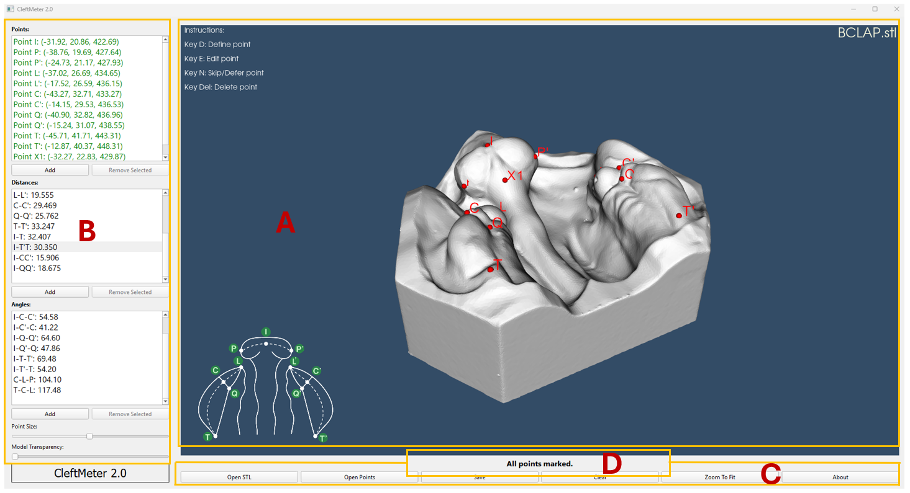
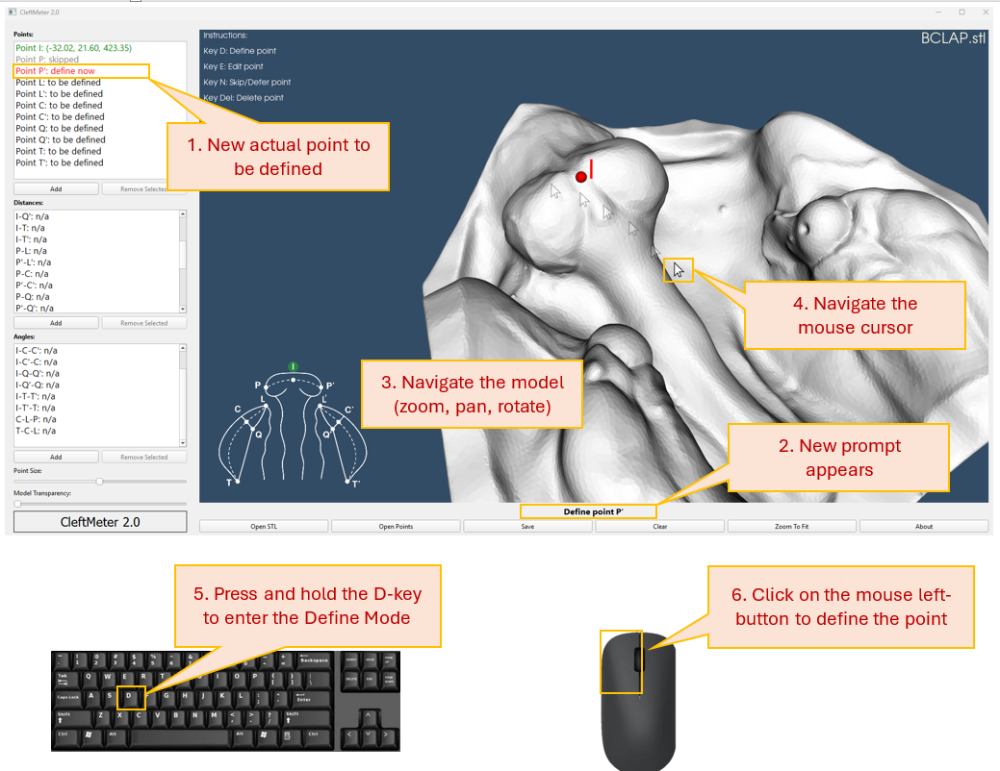
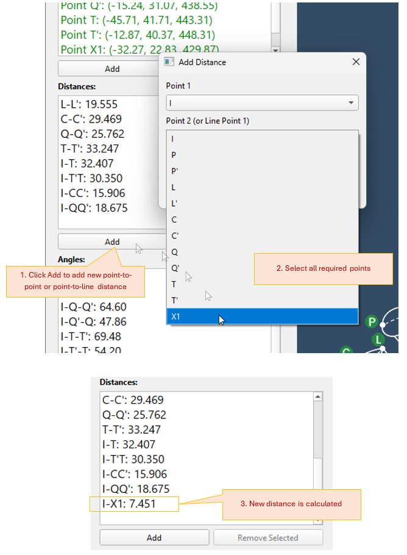
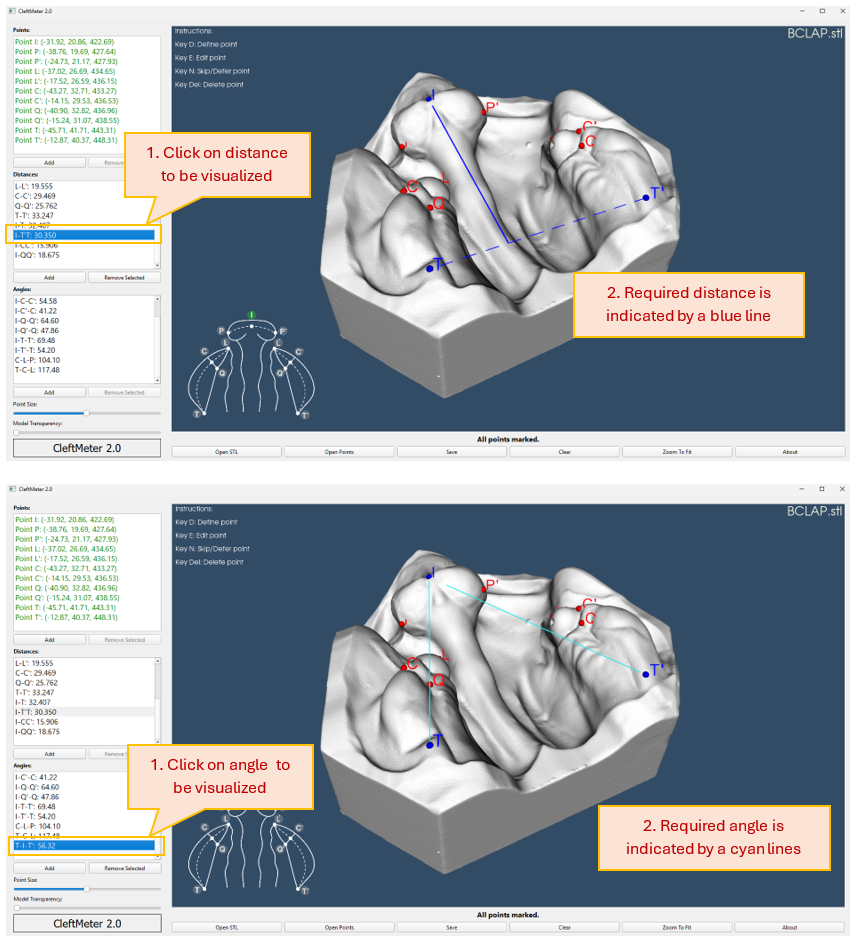
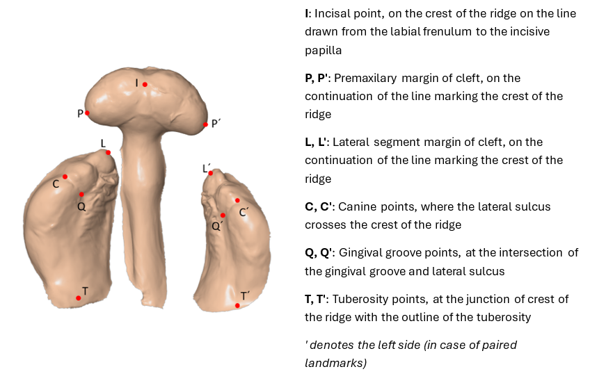
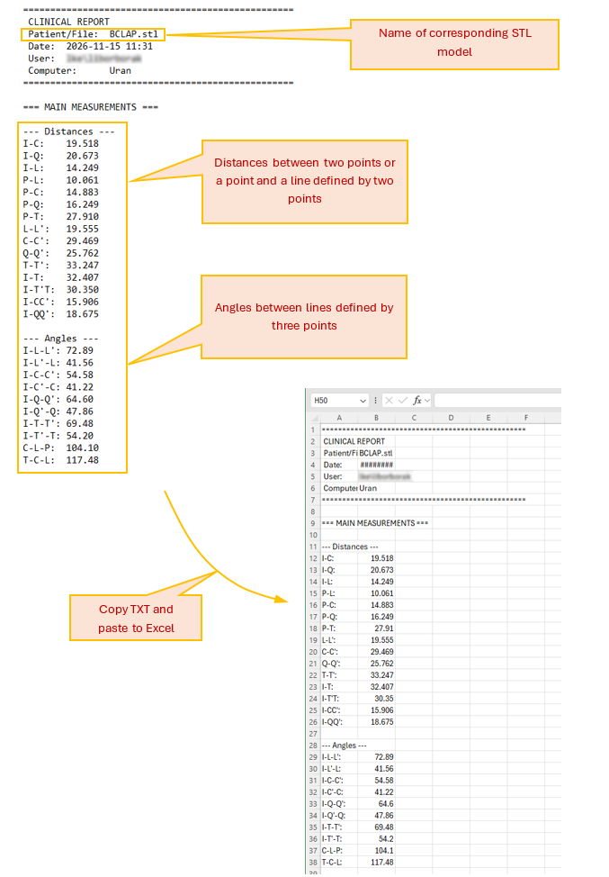

# CleftMeter

[](https://doi.org/10.5281/zenodo.16970748)  
[](LICENSE.txt)

## Authors

- **Libor Borák, Ph.D.**  
  Assistant Professor, Institute of Solid Mechanics, Mechatronics and Biomechanics,  
  Faculty of Mechanical Engineering, Brno University of Technology, Brno, Czech Republic  

- **Petr Marcián, Ph.D.**  
  Assistant Professor, Institute of Solid Mechanics, Mechatronics and Biomechanics,  
  Faculty of Mechanical Engineering, Brno University of Technology, Brno, Czech Republic  

- **Olga Košková, Ph.D.**  
  Assistant Professor, Department of Burns and Plastic Surgery, University Hospital Brno  
  and Faculty of Medicine, Masaryk University, Brno, Czech Republic;  
  Cleft Center of the University Hospital Brno, Brno, Czech Republic  

Version: **2.0**  
Date: **2026**  
Previous release: **[CleftMeter 1.0 (2025)](v1.0/README.md)**

---

## Table of Contents

1. [Introduction](#1-introduction)
2. [Installation and System Requirements](#2-installation-and-system-requirements)
3. [User Interface Overview](#3-user-interface-overview)
4. [Core Workflow: A Step-by-Step Guide](#4-core-workflow-a-step-by-step-guide)
   - 4.1 [Loading an STL Model](#41-loading-an-stl-model)
   - 4.2 [Defining Anatomical Points](#42-defining-anatomical-points)
   - 4.3 [Editing, Skipping, and Deleting Points](#43-editing-skipping-and-deleting-points)
   - 4.4 [Saving Your Work](#44-saving-your-work)
   - 4.5 [Loading Existing Work](#45-loading-existing-work)
5. [Managing Measurements](#5-managing-measurements)
   - 5.1 [Adding Custom Distances and Angles](#51-adding-custom-distances-and-angles)
   - 5.2 [Visualizing and Removing Measurements](#52-visualizing-and-removing-measurements)
6. [Anatomical Landmarks](#6-anatomical-landmarks)
7. [Data Export for Analysis (e.g., in Excel)](#7-data-export-for-analysis-eg-in-excel)
8. [Citation](#8-citation)

---

## 1. Introduction

CleftMeter is a specialized software tool designed for anthropometric analysis of 3D models, with a primary focus on maxillary arches in infants with cleft lip and palate. The application allows users to load a 3D model in the standard STL format, place a series of predefined anatomical landmarks, and automatically calculate distances and angles between them.

The software provides a streamlined workflow for researchers and clinicians, enabling consistent and repeatable measurements for clinical assessment, treatment planning, and research studies.

### What's New in CleftMeter 2.0

- User-defined custom landmark points (X1, X2, ...), which can be added and removed as needed.
- Automatic landmark side-consistency checking with a color-coded anatomical reference diagram.
- Improved point editing and deletion, including direct selection of existing points in the 3D workspace.
- A new `.cleftp` project format and a separate clinical TXT report, with support for importing TXT data files saved by CleftMeter 1.0.
- Protection against accidental loss of unsaved changes.
- Adjustable model transparency, customizable 3D workspace background color, and general interface improvements.

Documentation for the original release is available in the [v1.0 folder](v1.0/README.md).

---

## 2. Installation and System Requirements

CleftMeter is distributed in two formats to accommodate different user needs.

### a) Standalone Application (.exe)

This format is recommended for most users on the Windows operating system. No Python installation is required.

- **Installation:** Download the CleftMeter 2.0 Windows ZIP archive from [GitHub Releases](https://github.com/ismmb-bio/CleftMeter/releases/tag/v2.0), extract **all** its contents into a folder, and run `CleftMeter_v2.0.exe`. Keep the accompanying libraries and files together.
- **Requirements:** A modern Windows operating system (Windows 10 or newer is recommended).

### b) Python Script (.py)

This format is intended for developers or users on other operating systems (macOS, Linux) who are comfortable working with Python environments.

- **Installation:**
  1. Ensure you have Python (version 3.11 or newer, with compatible dependencies) installed on your system.
  2. This script requires several external libraries to function. The required libraries are:
     - **PySide6:** A framework for creating the graphical user interface (windows, buttons, lists).
     - **NumPy:** A fundamental package for scientific computing, used for mathematical operations with 3D coordinates.
     - **VTK (The Visualization Toolkit):** A library for 3D computer graphics, used to render the STL model and points.
  3. Install the required libraries using the following command:
     ```bash
     pip install PySide6 numpy vtk
     ```
  4. Download the files from the [v2.0 folder](v2.0/) and run the script:
     ```bash
     python CleftMeter_v2.0.py
     ```

**Important:** Keep `reference_points.png` in the same folder as `CleftMeter_v2.0.py` so the anatomical reference diagram can be displayed.

---

## 3. User Interface Overview

The main window of CleftMeter is divided into two primary sections: the **Control Panel** on the left and the **3D Viewport** on the right.



- **(A) 3D Viewport:** This is the main interactive window where your STL model is displayed. You can rotate, pan, and zoom the model here. In the top-left corner, a list of keyboard controls is visible. In the top-right, the name of the loaded STL file is shown. A reference landmark diagram with color-coded consistency indicators appears in the lower-left corner. Right-click the 3D workspace to change its background color.
- **(B) Control Panel:** Located on the left, this panel contains all the data and measurement tools.
  - **Points List:** Displays anatomical landmarks, their status (e.g., "define now", "skipped"), and their 3D coordinates once placed. The **Add** and **Remove Selected** buttons allow users to manage custom X points.
  - **Distances List:** Shows the calculated distances. You can add new custom distances or remove existing ones using the **Add** and **Remove Selected** buttons.
  - **Angles List:** Shows the calculated angles, with similar **Add** and **Remove Selected** functionality.
  - **Point Size Slider:** Allows you to adjust the visual size of points and their labels in the 3D viewport.
  - **Model Transparency Slider:** Adjusts the transparency of the STL model to improve landmark visibility.
- **(C) Main Toolbar:** A row of buttons at the bottom of the 3D viewport for file operations and view controls.
- **(D) Prompt Bar:** A status bar located just above the Main Toolbar. It provides instructions and guides you on the next action to perform (e.g., "Define point I").

---

## 4. Core Workflow: A Step-by-Step Guide

This section guides you through a typical measurement session.

### 4.1 Loading an STL Model

1. Launch the CleftMeter application.
2. Click the **Open STL** button on the Main Toolbar.
3. A file dialog will appear. Navigate to and select your `.stl` file.
4. The model will load into the 3D Viewport. The application will automatically reset the camera to fit the model in the view.

### 4.2 Defining Anatomical Points

After loading a model, the application enters point definition mode. The Prompt Bar will guide you to define the first point (e.g., "Define point I").

1. **Navigate the Model:**
   - **Rotate:** Hold the **left mouse button** and drag.
   - **Pan:** Hold the **middle mouse button** (or **Shift + Left Mouse Button**) and drag.
   - **Zoom:** Use the scroll wheel.
2. **Enter Define Mode:** Press and hold the **D** key on your keyboard. While this key is held down, the application is in "Define Point" mode.
3. **Place the Point:** With the **D** key held, move your cursor over the 3D model and left-click on the precise location where you want to place the landmark.
4. A red sphere and a text label for the point will appear on the model. The Points List will update with the coordinates, and the Prompt Bar will automatically advance to the next point in the sequence.
5. Repeat this process for all required points.



### 4.3 Editing, Skipping, and Deleting Points

You can modify points at any time.

- **To Edit a Point:**
  1. Press and hold the **E** key. The prompt will change to editing mode.
  2. While holding **E**, select the point you wish to edit, either in the **Points List** or directly on the **3D model**. It will be highlighted in green.
  3. Release the **E** key. You can rotate or inspect the model before placing the point in a new position.
  4. Press and hold **E** again, and left-click on the model to set the new location for the selected point. Press **Escape** to cancel a pending edit.

- **To Skip a Point:**
  If you are prompted to define a point but cannot place it (e.g., the landmark is not visible or applicable), simply press the **N** key. The point's status will change to "skipped" in the Points List, and the application will move to the next point.

- **To Delete a Point (Reset its status):**
  1. Press and hold the **Delete** key.
  2. While holding **Delete**, select the point you wish to remove, either in the **Points List** or directly on the **3D model**.
  3. The point's coordinates will be erased, and its status will be reset to "skipped".

- **To Add or Remove Custom Points:**
  Use **Add** below the Points List to create additional landmarks labeled X1, X2, and so on. Select a custom point in the list and click **Remove Selected** to remove it permanently. Predefined anatomical landmarks cannot be removed from the list.

### 4.4 Saving Your Work

CleftMeter 2.0 saves the complete project and a separate clinical TXT report.

1. Click the **Save** button on the Main Toolbar.
2. The application saves two files in the same directory and with the same base name as the loaded STL model. For example, if you loaded `patient_01.stl`, it will create:
   - **`patient_01.cleftp`** — the project file, containing landmark coordinates and states, custom points, and distance and angle definitions. Use this file to resume work.
   - **`patient_01.txt`** — the clinical report containing calculated distances, angles, and any detected landmark side-consistency warnings.
3. Existing files with these names are overwritten when saving. Keep backups when necessary.

The application warns you about unsaved changes before certain actions that would discard the current session.

### 4.5 Loading Existing Work

You can continue a previously saved session or import data from an earlier version.

1. First click **Open STL** and load the corresponding `.stl` model.
2. Click **Open Points**. The application first looks in the STL folder for a matching `.cleftp` project file and, if none is present, for a matching `.txt` file. If neither is found, a file dialog allows you to select a project or TXT file manually.
3. To resume a CleftMeter 2.0 session, load its `.cleftp` file. The application restores the saved points and measurement definitions.

**Backward Compatibility:** CleftMeter 2.0 can also open TXT files saved by CleftMeter 1.0, importing landmark coordinates and distance and angle definitions from their `[POINTS]`, `[DISTANCES]`, and `[ANGLES]` sections. The simpler `Point I: x y z` text format is supported as well. After importing older data, save your work in the new `.cleftp` format.

**Note:** The clinical TXT report generated by CleftMeter 2.0 is intended for reading and exporting measurement results; it does not replace the `.cleftp` project file for reopening an editable session.

---

## 5. Managing Measurements

CleftMeter comes with a default set of distances and angles, but you can also define your own.

### 5.1 Adding Custom Distances and Angles

1. Make sure you have at least two (for distances) or three (for angles) points defined.
2. Under the **Distances** or **Angles** list, click the **Add** button.
3. A dialog window will appear. Use the dropdown menus to select the points you want to use for the new measurement.
   - **For a Point-to-Point Distance:** Select two points and leave the third dropdown as "NONE".
   - **For a Point-to-Line Distance:** Select three points. The distance from the first point to the line formed by the second and third points will be calculated.
   - **For an Angle:** Select three points. The angle will be measured at the second point selected (the vertex).
4. Click **OK**. The new measurement will appear in the corresponding list.



### 5.2 Visualizing and Removing Measurements

- **To Visualize:** Simply click on any distance or angle in its list. The corresponding points and a line (or lines) representing the measurement will be highlighted in the 3D Viewport.
- **To Remove:** First, click on the measurement in the list to select it. Then, click the **Remove Selected** button. You will be asked to confirm the deletion.



---

## 6. Anatomical Landmarks

CleftMeter is pre-configured with a set of landmarks commonly used in the analysis of maxillary arches in infants with clefts. The default landmarking scheme is based on the methodology described by Seckel et al.

- **Default Landmarks:** I, P, P', L, L', C, C', Q, Q', T, T'



CleftMeter 2.0 also allows users to define additional custom landmarks (X1, X2, ...) for measurements that are not covered by the predefined scheme.

### Landmark Side-Consistency Check

After all predefined landmarks have been defined or skipped, CleftMeter automatically checks the relative side assignment of the paired landmarks P/P', L/L', C/C', Q/Q', and T/T'. The reference diagram in the 3D Viewport uses color-coded indicators:

- **Green:** Landmark defined and no side-consistency issue detected.
- **Grey:** Consistency not yet established or cannot be reliably determined.
- **Red:** Possible side inconsistency that requires review.

The check helps identify potential confusion between primed and unprimed labels. It does not verify the anatomical accuracy of the landmark positions; all points should be checked visually against the individual STL model.

For a detailed definition and clinical significance of each of these landmarks, users are advised to consult the following publications:

- Seckel NG, van der Tweel I, Elema GA, Specken TF. *Landmark positioning on maxilla of cleft lip and palate infant--a reality?* Cleft Palate Craniofac J. 1995 Sep;32(5):434-41. doi: 10.1597/1545-1569_1995_032_0434_lpomoc_2.3.co_2. PMID: 7578209.
- Košková O, Borák L, Urbanová W, Bryšová A, Nováková M, Richtrová M, Streit L, Štourač P, Marcián P. *Comparison of silicone impressions with intraoral 3D scans in newborns with cleft lip and palate.* J Prosthet Dent. 2025 Jul;134(1):275-282. doi: 10.1016/j.prosdent.2025.02.054. Epub 2025 Mar 27. PMID: 40148199.

---

## 7. Data Export for Analysis (e.g., in Excel)

CleftMeter 2.0 generates a human-readable clinical TXT report containing calculated distances, angles, session information, and any detected landmark side-consistency warnings. The complete editable project, including landmark coordinates and measurement definitions, is stored separately in a `.cleftp` file.

The clinical TXT report can be opened in a text editor or copied into spreadsheet software such as Microsoft Excel for further analysis. Unlike the tabular TXT files saved by CleftMeter 1.0, the new report is organized for clinical reading rather than direct import as a complete dataset.

To export your data:

1. After saving your work, locate the `.txt` report on your computer.
2. Open the file with a simple text editor (like Notepad on Windows or TextEdit on macOS).
3. Press **Ctrl+A** to select all the text.
4. Press **Ctrl+C** to copy the text to the clipboard.
5. Open Microsoft Excel (or another spreadsheet program) to a blank sheet.
6. Click on cell **A1**.
7. Press **Ctrl+V** to paste the data.

The report contains tab-separated measurement labels and values, which can be arranged into columns for subsequent analysis if needed.



**Note on Data File Compatibility:** CleftMeter 2.0 can read the tab-separated TXT files saved by CleftMeter 1.0, including their `[POINTS]`, `[DISTANCES]`, and `[ANGLES]` sections. This allows existing measurement sessions to be transferred to the new project format. For an explanation of the original v1.0 data export, see the [CleftMeter 1.0 documentation](v1.0/README.md).

---

## 8. Citation

For citations of **CleftMeter 2.0**, refer to the [CITATION.cff](CITATION.cff) metadata and identify the version used:

> Borák L, Marcián P, Košková O. *CleftMeter* (Version 2.0) [Computer software]. 2026. [GitHub Release v2.0](https://github.com/ismmb-bio/CleftMeter/releases/tag/v2.0). Concept DOI: [10.5281/zenodo.16970748](https://doi.org/10.5281/zenodo.16970748).

**DOI note:** The Concept DOI identifies the CleftMeter software series. Until CleftMeter 2.0 receives its own version-specific Zenodo record, its release is available through GitHub; the Concept DOI should not be mistaken for a version-specific archive of v2.0.

For the original CleftMeter 1.0 release and its citation information, see [v1.0](v1.0/README.md) (Version DOI: [10.5281/zenodo.16970749](https://doi.org/10.5281/zenodo.16970749)).
